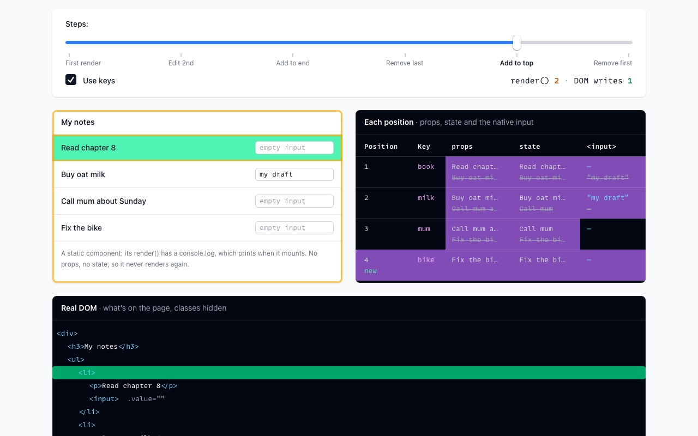
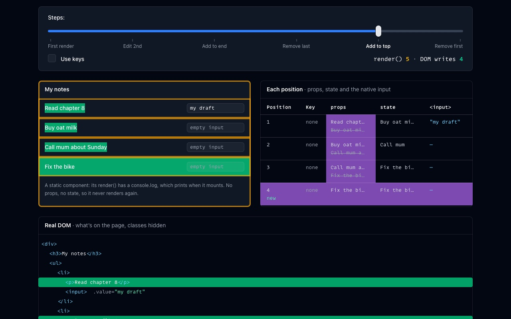
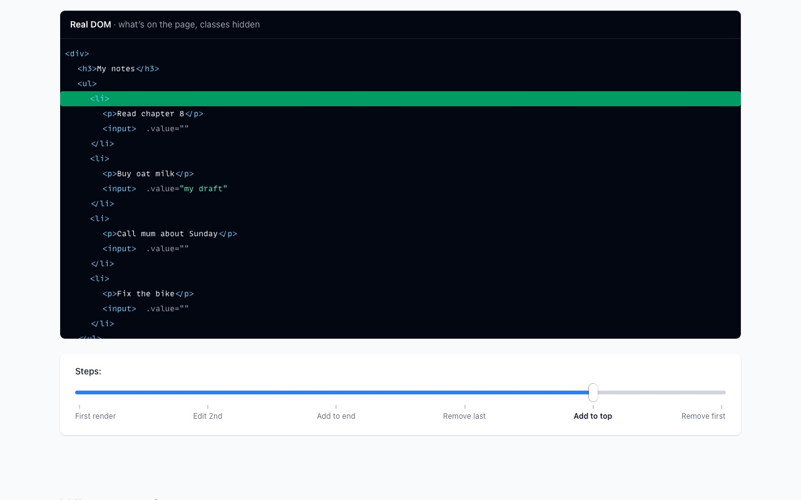

<div align="center">

# fe-fwk-ts-react

**Render is cheap. The DOM is not.** A TypeScript port of the framework from the book [Build a Frontend Web Framework (From Scratch)](https://www.manning.com/books/build-a-frontend-web-framework-from-scratch) by Ángel Sola Orbaiceta, with React's names, and a demo that counts what each edit really costs.

### [▶ Try it at react.avolkov.dev](https://react.avolkov.dev)

Best in Safari on a Mac. Works on a phone.

<!-- Happy-path video: drag /private/tmp/claude-501/-Users-alex-Downloads-github/eba4b07d-fb10-47d6-8ce4-42740ad111e8/scratchpad/media/fe-fwk-ts-react/fe-fwk-ts-react-happy-path.mp4 onto this line in the GitHub editor -->

  

</div>

## The demo

A notes list goes through five edits. For each one the page shows how many components ran `render()`, how many times the DOM really changed, a table of every position's props, state and native `<input>` value, and the real DOM. A checkbox turns keys off, to show when they matter and when they don't.

The runtime was written with Claude Code and checked by an independent judge: the same edits are applied to this runtime and to `react-dom` 19, and after every edit both DOMs must be identical ([fast-check](https://fast-check.dev) generates 600 random lists and edit sequences per run). 212 tests, including the book's own suite ported to TypeScript.

## Names: the book, this port, React

| Book | This port | React |
|---|---|---|
| `h()` | `createElement()` | `React.createElement()` |
| `defineComponent()` | `createComponent()` | `class extends React.Component` |
| `updateState()` | `setState()` | `this.setState()` |
| `onMounted()` | `componentDidMount()` | `componentDidMount()` |
| `onUnmounted()` | `componentWillUnmount()` | `componentWillUnmount()` |
| `emit("add")` | `emit("add")` | a callback prop: `props.onAdd()` |
| `vdom.el` | `vNode.domElement` | `fiber.stateNode` (internal) |
| `areNodesEqual()` | `areVNodesEqual()` | same type and same `key` |
| `createApp().mount()` | `createApp().mount()` | `createRoot().render()` |

One difference from React: a component whose props didn't change skips `render()`, as `React.memo` does. Known limitation, shared with the book: a component whose fragment becomes empty can't find its place in the parent.

## Run it locally

Needs Node 24 or newer.

```sh
git clone --depth 1 https://github.com/slimcandy/fe-fwk-ts-react.git
cd fe-fwk-ts-react
npm install
npm test               # the book's tests and the comparison with react-dom
npm run dev            # the demo at http://localhost:5173
npm run build          # rebuilds packages/runtime/dist (committed, the demo imports it)
npm run build:site     # the demo into examples/notes/dist
```

The runtime isn't on npm: it's a learning project, so you clone it.

```js
import { createApp, createComponent, createElement } from "fe-fwk-ts-react";

const Counter = createComponent({
  state() {
    return { count: 0 };
  },
  render() {
    const { count } = this.state;
    return createElement("button", { on: { click: () => this.setState({ count: count + 1 }) } }, [
      `Clicked ${count} times`,
    ]);
  },
});

createApp(Counter).mount(document.body);
```
